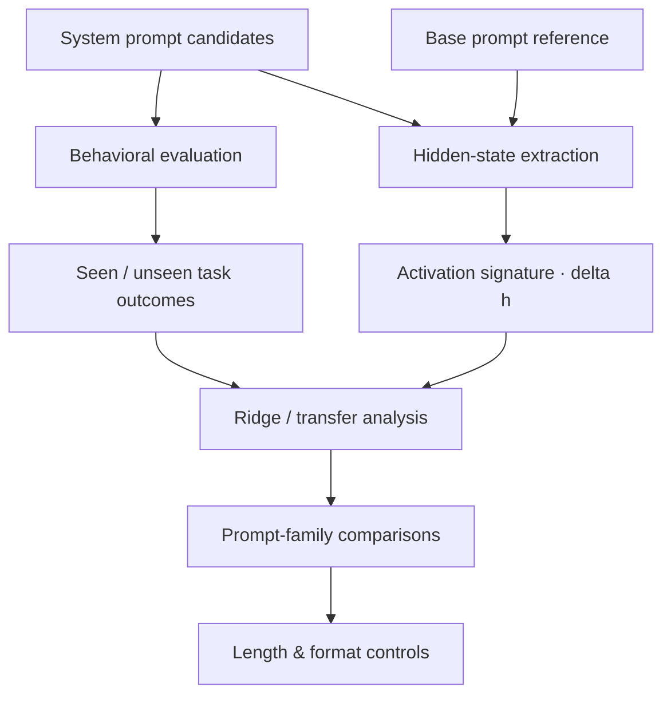

<div align="center">

# 🔬 SCOUT

### System-Prompt Candidate Ordering Using Hidden-State Traces

**What can hidden activations tell us about prompt behavior?**  
시스템 프롬프트의 성능과 모델 내부 표현을 함께 분석해, 과제 간 전이와 후보 선별 가능성을 탐구합니다.


[Question](#research-question) · [Approach](#method) · [Findings](#key-findings) · [Run](#reproduce) · [Limitations](#what-this-does-not-prove)

</div>

---

## Research Question

**왜 어떤 시스템 프롬프트는 특정 과제에서만 잘하고, 다른 과제에서도 일관되게 좋은 성능을 내는 프롬프트는 무엇이 다를까?**

시스템 프롬프트는 같은 모델의 출력 길이, 추론 양식, 정답 형식과 정확도를 바꿀 수 있습니다. SCOUT은 단순히 점수가 높은 프롬프트를 찾는 대신 **내부 activation이 이런 성능·행동 차이와 어떤 관계가 있는지** 살펴봅니다.

이 저장소는 *seen/unseen task transfer 및 prompt principle 분석*을 중심으로 하며, 별도의 [연구 노트](https://app.notion.com/p/35106d3e4524805995bdffed6c7ee3a3)에는 **65개 reference prompt × 8개 task 기반의 activation-guided pre-screening 실험**도 정리되어 있습니다. 두 결과의 실험 설정과 주장 범위는 구분해서 읽어야 합니다.

## Method



- **Behavioral evaluation:** 서로 다른 system prompt로 여러 과제의 정확도를 측정
- **Activation extraction:** `Δh = h(prompt) − h(base prompt)`를 layer/token position별 추출
- **Analysis:** Ridge/activation 비교를 통해 전이 성능과 내부 표현의 관계를 검토
- **Controls:** 길이·출력 형식·paraphrase와 같은 혼란 요인을 별도 분석

### Representative transfer setup

| Stage | Examples |
|:--|:--|
| Seen tasks | GSM8K, CSQA |
| Unseen tasks | SVAMP, BoolQ |
| Model families | Qwen, Llama, Gemma |
| Activation locations | `system_last_token`, `first_user_token`; early/mid/late layers |

[Lab meeting notes →](docs/lab_meeting_final_ko.md)

## Key Findings

### 01 · Hidden states contain a behavioral signal

| Model in reported transfer run | Activation predictor R² | Activation top-k unseen | Random top-k unseen |
|:--|--:|--:|--:|
| Qwen2.5-7B | 0.438 | 0.585 | 0.480 |
| Hermes-3 Llama-3.1-8B | 0.405 | 0.789 | 0.644 |
| FuseChat-Gemma-2-9B | 0.256 | 0.640 | 0.543 |

**Interpretation:** 이 실험에서 activation 기반 후보 선택이 무작위 선택보다 나은 결과를 보였지만, *seen-task 성능을 이용한 기준선보다 항상 좋은 것은 아니었습니다.* 따라서 “내부 표현만으로 최적 프롬프트를 찾았다”는 결론은 아닙니다.

### 02 · Smaller prompting cues mattered

`concise`, `careful`, 최소한의 정답 형식 지정처럼 **간결한 지시 계열**이 강한 전문가 역할 부여나 긴 단계별 추론 지시보다 안정적으로 나타나는 경향을 관찰했습니다. 다만 최적 조합은 모델마다 달랐습니다.

### 03 · A failed selector was an important result

단순 **activation centroid cosine**을 그대로 선택 점수로 사용했을 때 일관된 성능 개선이 나타나지 않았습니다. 단일 레이어·토큰 activation patching만으로 프롬프트 행동을 재현하는 것도 충분하지 않았습니다.

**결론:** 내부 활성값은 모델 행동을 분석할 단서가 될 수 있지만, 강한 인과 설명이나 모든 모델에 통하는 범용 프롬프트 선택기로 해석해서는 안 됩니다.

[Full result summary →](docs/final_results_summary.md) · [Discussion →](docs/lab_meeting_final_ko.md)

## Repository Guide

| Path | Purpose |
|:--|:--|
| [`scripts/run_eval.py`](scripts/run_eval.py) | Prompt별 모델 출력과 행동 성능 평가 |
| [`scripts/extract_activation.py`](scripts/extract_activation.py) | Hidden-state extraction, `Δh` features |
| [`scripts/run_analysis.py`](scripts/run_analysis.py) | Transfer/activation diagnostics |
| [`scripts/run_length_confound_analysis.py`](scripts/run_length_confound_analysis.py) | 출력 길이 등 confound 점검 |
| [`configs/`](configs/) | 모델·과제별 실행 설정 |
| [`data/`](data/) | 프롬프트 및 데이터 입력 포맷 |
| [`docs/`](docs/) | 실험 결과 및 연구 회고 |
| [Original detailed README](docs/README_BEFORE_PORTFOLIO_REFRESH.md) | 기존 전체 실험 설정·프롬프트 출처·실행 기록 |

## Reproduce

> GPU와 Hugging Face 모델 접근 및 **실제 벤치마크 데이터**가 필요합니다. 저장소의 일부 입력 파일은 빠른 확인을 위한 소규모 예시입니다.

```bash
git clone https://github.com/Ai-pre/SCOUT-System-prompt-Candidate-Ordering-Using-hidden-state-Traces.git
cd SCOUT-System-prompt-Candidate-Ordering-Using-hidden-state-Traces

python -m pip install -r requirements.txt
python scripts/prepare_datasets.py

python scripts/run_eval.py --config configs/config.gpu_general_mixed.yaml
python scripts/extract_activation.py --config configs/config.gpu_general_mixed.yaml
python scripts/run_analysis.py --config configs/config.gpu_general_mixed.yaml
```

프로그램이 실행 가능하더라도 GPU·데이터셋·모델 버전이 같지 않으면 동일 결과를 자동 보장하지 않습니다. 원래 실험의 다양한 config/ablation은 [전체 실행 가이드](docs/README_BEFORE_PORTFOLIO_REFRESH.md)를 참고하세요.

## What This Does Not Prove

- Activation과 높은 성능 사이의 **인과관계**를 증명한 것은 아닙니다.
- 모델·과제별 최적 프롬프트가 하나로 수렴하는 것은 아닙니다.
- Raw centroid similarity는 단독 선택기로 신뢰하기 어렵습니다.
- 작은 규모의 선별·진단 결과는 새로운 모델·새로운 task에서 별도 검증이 필요합니다.

---

<div align="center">

**Understanding prompt behavior beyond a single accuracy score.**

[Portfolio ↗](https://ai-pre.github.io/Ai-pre/) · [Research notes ↗](https://app.notion.com/p/35106d3e4524805995bdffed6c7ee3a3)

</div>